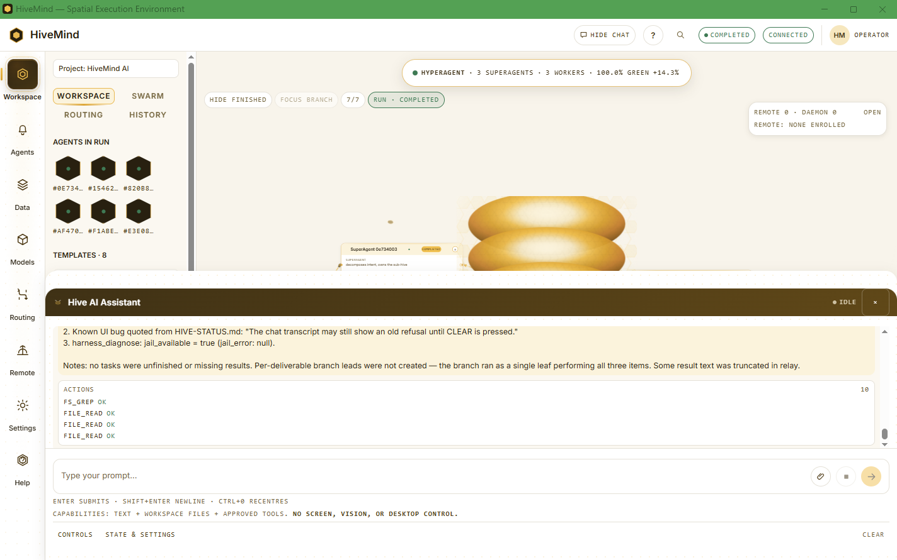
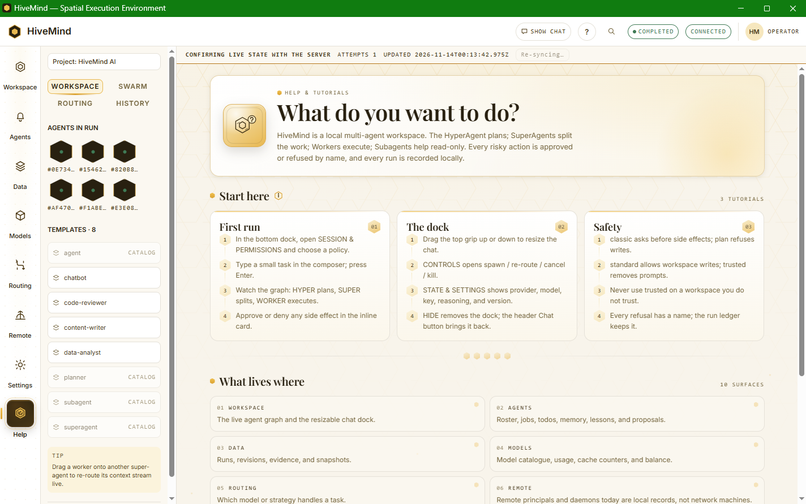
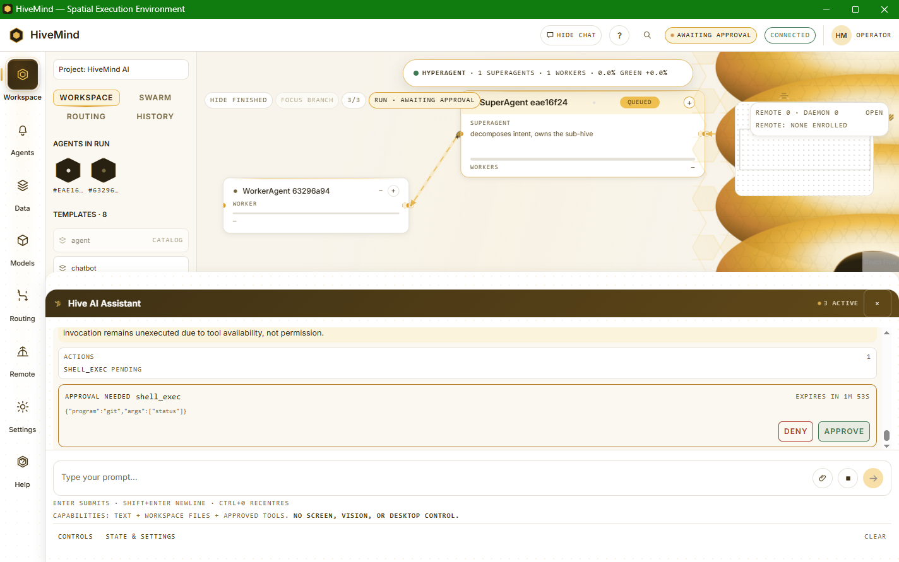

# HiveMind — local, approval-gated HMAS prototype

**Short description:** A local, single-provider, hierarchical multi-agent prototype for Windows.
It plans bounded runs, delegates to SuperAgents/Agents/Subagents, gates side effects behind operator
approval, persists evidence in SQLite, and refuses live work when no DeepSeek key is configured.
It is **not AGI**, not a self-modifying agent, and not yet a general coding harness.

**Working tree:** `1.2.0-dev` (unreleased). **Sealed release:** `1.1.0` — the sealed
version remains the release authority; the working tree is pre-release and unsealed.

**Truth baseline (observed 2026-11-12, integration branch):** capability work is
on `integration/capability-absorb`; schema is **v32** (sessions/policy, repo index,
checkpoints, jobs, executed eval, evidence-gated lessons, eval suites/metrics); the registry has **24 tools / 89 grants / 80 named refusals**;
`/health` is `ok` on a configured profile; docs truth checker **19/19 PASS**; the
full backend workspace gate and the full web gate pass. This is **pre-release**
work, not a clean release seal; the sealed `1.1.0` remains the release authority.

**Recent verified fixes (2026-11-13):** workspace reads are no longer denied when
the workspace lives inside the data root; `harness_diagnose` is a real
read-only agent tool with health/log/workspace scopes; blocked child reports are
persisted as failed instead of completed; pending approvals for terminal runs are
filtered out; expired approvals can be dismissed locally; the root HyperAgent
reads only its direct managers' compressed results; and every planned seat now
receives its own objective instead of the whole run prompt. Evidence:
`docs/evidence/delegation-audit-20261113-163346.md` and
`docs/research/HIERARCHICAL-DELEGATION.md`.

Read the full evidence and boundary before relying on any claim:
[truth report](docs/audit/HIVEMIND-TRUTH-AND-ROADMAP-2026-11-10.md),
[plan-status crosswalk](docs/plans/HIVEMIND-FINISH-PLAN-v3-STATUS.md),
[100 use cases and 100 cannots](docs/audit/round-95/06-use-cases.md).

## The running app



Captured from the installed Windows build (`88a23cd`) on the live local server:
the full-width bottom chat dock, Controls / State & settings tray, run-status chip,
agent run list, and the completed three-SuperAgent run detail.





## Capability status (wired vs library-only)

These are the current boundaries, not a feature wish-list:

- **Wired and exercised:** local server + SQLite, planner → HyperAgent → SuperAgent → worker
  DAGs with per-seat objectives, approvals, run history, tool calls (`file_read`, `fs_glob`,
  `fs_grep`, `file_read_range`, `apply_patch`, `run_tests`, git read/write tools,
  `shell_exec`, `harness_diagnose`), workspace jail with data-file denies, `/api/logs`,
  `/diagnose`, repo symbol search (`repo_search`), session-scoped run seeding (cross-run memory), the MCP stdio server in
  `tools/hivemind-mcp`, and the workbench UI panels.
- **Library primitives wired into the crate, not yet exposed as agent tools/routes:**
  per-tree chat bus (`chat_bus.rs`), delegation seat protocol (`delegation_protocol.rs`),
  lexical semantic recall (`semantic_recall.rs`), HiveWire in-process queue + lease
  scheduler (`hivewire.rs`/`remote_store.rs`/`daemon_store.rs`), file-checkpoint restore
  (`checkpoint.rs`/`repo_index.rs`). The session model is
  wired for run seeding; it has no separate resume HTTP route yet.
- **Not present:** autonomous coding/self-modification, a continuous daemon, OS
  filesystem/network sandboxing, network remote transport, embeddings/ANN, automatic
  weight/skill/code learning, and a live 40-node provider proof.

A primitive in the second list is real code with tests, but it is **not** a
user-callable feature until the route/tool wiring lands. Do not cite it as shipped.

---

## 1. What this actually is

HiveMind is a **local, single-provider, single-run hierarchical multi-agent
system (HMAS)**. One root HyperAgent makes one planning call, has **two bounded
pre-dispatch control turns**, dispatches a DAG of SuperAgents → Agents →
Subagents under hard caps, settles tasks, makes **one read-only post-dispatch
monitor review**, and produces a tool-less final answer. It persists runs,
messages, tool turns, approvals, memory banks, snapshots and a run ledger in
SQLite under a local data directory.

It is not a continuous daemon, a cloud service, a self-modifying system, a
vector-memory product, HiveWire, an autonomous coding employee, or AGI.

Provider streaming is implemented: ordered text fragments are forwarded as
`REPLY_DELTA` events and settled by `REPLY_DONE`; malformed or incomplete
streams refuse by name. This is real SSE/token streaming, not a fake one-delta
reply. Evidence: `backend/crates/hiverouter-provider/src/client.rs` and
`provider_executor.rs` streaming paths; the full battery covers the streaming
suites.

```text
submit(prompt)
  → bounded planner call(s) → DAG validation (one repair allowed)
  → root control turn 1: create/assign/remote/daemon/memory/proposal/finish
  → root control turn 2: feedback; creation refused
  → dispatch ready tasks; settle unfinished tasks
  → one read-only monitor review (no tools)
  → final synthesis (no tools)
  → persist terminal state/usage/snapshot
```

---

## 2. Roles, caps, and tools

| Role | Actual runtime | Real authority | Limits |
|---|---|---|---|
| **HyperAgent** | Root `planner` task, depth 0 | Plan; two bounded control turns; create remotes/daemons; read memory summaries; propose improvement; review results; final answer | No mid-flight supervision; no `send_instruction`/`cancel_task`/repair; no self-modification |
| **SuperAgent** | Depth-1 branch lead, `super`, hive bank | Spawn Agents; aggregate children; A2A; read/list; request detached; web fetch; vote evolution | Write/shell only through its effective tier∩persona surface; no direct remotes/daemons |
| **Agent (Worker)** | Depth-2 task executor, branch bank | Spawn Subagents; approval-gated write/shell; read/list; A2A; request detached; web fetch | No remotes/daemons; no root authority; caps/jail |
| **Subagent** | Depth-3 temporary leaf | Read/list, ask parent, report, finish | No spawn/write/shell/network/detached admission |
| **Remote** | In-process fixture principal + device + grant | Appear in the remote lane; be actuated through a grant | No model, no internet, no task tree, no network satellite |
| **Daemon** | Enrolled tree-free record | Be enrolled; report a DB check when its tick path is driven | No continuously scheduled OS process; no live tick proof |
| **ToolAgent** | Census tier only | Nothing in production | No shipped producer |

**Hard caps:** depth **3**, fan-out **8**, **64** agents/run, **64** provider
calls/run, 40 plan nodes, 12 tool turns, 40 tool calls/run, 8 approval waits/run,
64 KiB tool result, $0.50/run, 400,000 combined tokens/run. Root control is ≤4
calls/turn and up to 2 turns. Refusals are named (`E_SPAWN_DEPTH`,
`E_FANOUT_LIMIT`, `E_AGENT_LIMIT`, `E_CALL_LIMIT`, etc.), never silent clamps.

**Tools — 22 registry tools, 5 permission classes, 81 tier grants.** The original 12 tools remain; capability work adds jailed filesystem search/read, atomic patch, bounded test runner, and git read/stage/commit lanes.
Effective surface is **tier ∩ persona**, so a tier grant can be hidden by a
persona.

| Tier | Registry allowlist |
|---|---|
| HyperAgent | 13 registry grants; root control is a separate local vocabulary, so these grants are not the root control surface |
| SuperAgent | 22 grants: original management/read/write/shell/web/detached/vote set plus the 10 coding tools |
| WorkerAgent | 21 grants: original worker set plus the 10 coding tools |
| Subagent | 11 grants: read/list/ask/report/finish plus read-only search and git-read tools |
| ToolAgent | 14 grants in the census; no production producer |

Capability additions extend the same tier allowlists: `fs_glob`, `fs_grep`, `file_read_range`, `apply_patch`, `run_tests`, `git_stage`, `git_commit`, `git_status`, `git_diff`, `git_log`. The census test derives the totals; they are not hand-maintained counts.

Root-control vocabulary (local, not registry): `spawn_superagent`,
`assign_task`, `spawn_remote_agent`, `spawn_daemon`, `read_memory_summary`,
`propose_improvement`, `finish`. `spawn_superagent` is currently advertised but
refused whenever the planner supplied a branch; `convene_evolution_vote` is not
in the root tool schema.

**Safety limits:** `file_write`/`shell_exec`/`web_fetch` require approval;
shell is allowlisted to `git.exe`/`cargo.exe` and refuses command-interpreter
hosts, but remains **approval-gated arbitrary code execution, not an OS
sandbox**. `web_fetch` is HTTPS-only, no redirects, no private networks, 1 MiB.
File tools are jailed to the workspace and capped at 1 MiB.

---

## 3. What works without a key

The installed app boots and serves its UI/read/operator surfaces with
`status:"degraded"` and `E_KEY_MISSING` when no key is configured. Usable today:

- `/health`, `/diagnose`, `/api/runtime`, `/api/session`, `/api/templates`.
- Workspace tree/read preview, approvals surface, history/revisions/snapshots.
- Memory banks/journal/verification, proposals/lessons readbacks.
- Agent roster, profiles, messages, A2A inbox, remote/daemon/audit reads.
- CLI `version`, `preflight`, `schema`, `tools.list`, `tools.describe`,
  `capabilities.census`, `provider.cost`, `health`, `diagnose`, `db.backup`.
- Crash/restart and scale test drills.

**Every live prompt, model tool loop and model-dependent feature refuses
`E_KEY_MISSING` until a DeepSeek key is configured.** No fake run is produced.

---

## 4. What it cannot do (current truth)

- No autonomous coding, self-modification, continuous agent, or goal loop.
- No file-diff review or integrated terminal/PTY yet; the Data surface now
  mounts the real workbench file tree and a read-only editor over workspace
  reads, while the remaining workbench panes exist unmounted.
- Repository index/search exists as an additive module and API surface, and a
  bounded, labelled workspace-context block is injected into planning and task
  prompts at engine build; exact content still comes from file tools.
- File checkpoints are wired for approved `file_write`/`apply_patch` mutations
  and exposed through checkpoint routes; there is no general editor undo UI yet.
  Graph snapshots remain run-state history, not a substitute for file rollback.
- No monitor actions; the post-dispatch review cannot instruct, cancel, or
  repair a task.
- No vector database, embeddings, ANN, or semantic recall; memory is SQLite
  banks with recency retrieval and admits unverified entries.
- No automatic learning loop. Lessons are prompt-injected data after a
  receipt-gated apply; no weights/skills/tools/code change.
- No HiveWire implementation in this repository; `ws.rs` is the UI WebSocket.
- No network remotes; remotes are in-process fixtures; daemons have no live
  scheduler.
- The packaged agent-native CLI (`hivemind.cmd`) supports headless status/run/read/mutate commands; the MCP stdio server exposes read-only `hivemind_status`, `hivemind_runs`, and `hivemind_jobs`. There is no extension API or fully documented HTTP contract.
- No OS sandbox; `shell_exec` is approval-gated arbitrary code.
- No live 40-node provider run, clean-profile install proof, or strict release
  seal; no keyed live proof is claimed in this repository.

---

## 5. Install and current build

There is **no public downloader, MSI, code signing, or auto-updater**. The local
package is built from this tree:

```powershell
$root = "C:\Users\Riley\Desktop\hiverouter-v1"
powershell.exe -NoProfile -ExecutionPolicy Bypass -File "$root\tools\build-desktop.ps1"
powershell.exe -NoProfile -ExecutionPolicy Bypass -File "$root\tools\install-desktop.ps1" -SkipProvider
```

Prerequisites: Windows x64, Node/npm, Rust/cargo with bundled `tools\w64devkit`,
Git, and .NET Framework `csc.exe`. Install is per-user under
`%LOCALAPPDATA%\Programs\HiveMind\app`; data under `%LOCALAPPDATA%\HiveMind`.
Desktop/Start Menu shortcuts are created.

Current portable package identity is recorded at build time in
`dist/HiveMind/BUILD.json` (commit/version/built_at/server and launcher hashes,
`dirty` flag) and `dist/HiveMind/CHECKSUMS.txt` (every packaged file except the manifest itself). Do not
copy hashes into prose: they change on each rebuild. The last verified rebuild
was 2026-11-12, `dirty:false`, schema v32, with CLI and MCP included.

The install/health receipt is under [docs/evidence/live/](docs/evidence/live/);
the current index is [INDEX.md](docs/evidence/live/INDEX.md). Health is
`degraded` on this profile only because `DEEPSEEK_API_KEY` is absent.

---

## 6. EVO-GATE and learning — real but partial

The legacy proposal path (`applied:false`, `requires_human_review:true`) still
requires four designated SuperAgent seats plus the operator. Before its lesson
line can be appended, the operator must place a held-out evaluation receipt at
`<data_dir>/evolution/eval/<proposal>/receipt.json`.

The newer CAP-9 lesson-candidate path is different and deliberately weaker:
activation requires two **passing executed-eval receipts for the same suite/case**
(not four votes and not a held-out receipt), and rollback appends a tombstone
that removes the lesson from the prompt set. It does not run a non-inferiority
comparison yet.

The gate validates schema/proposal binding, ≥8 tasks, task-set/evaluator/artifact
hashes, confidence intervals and `candidate.ci_lower > baseline.ci_upper`; boot
rejects receipt-less lesson lines. It **does not run the evaluator**, compare
`head_commit` to HEAD, or bind artifact hashes to real files. A well-formed
hand-authored receipt can pass. Lessons are prompt data only; no code, schema,
tool grant, prompt file, weight or gate is mutated.

There is **no automatic learning loop** and no vector memory. See
[01-core.md](docs/audit/round-95/01-core.md) for the full evidence.

---

## 7. Evidence and claim ledger

| Claim | Grade | Evidence |
|---|---|---|
| 22 registry tools, 5 classes, 81 grants | **READ** | `backend/crates/hiverouter-tools/src/tool.rs:115-250`; `census.rs` |
| Caps depth 3/fan-out 8/64 agents/64 calls | **READ** | `backend/crates/hiverouter-core/src/caps.rs:7-18` |
| Root control 2 turns, ≤4 calls, turn-2 creation refusal | **READ** | `execution.rs`; `provider_executor.rs` |
| Monitor is one read-only turn; no action tools | **READ + TEST** | `execution.rs:2342-2398`; `run_lifecycle.rs` |
| EVO-GATE is shape-validating, not evaluator-executing | **READ** | `evolution_gate.rs:13-15,76-166` |
| No vector/embedding memory | **READ (absence)** | schema/code search; `store.rs:2217-2286` |
| No HiveWire | **READ (absent)** | zero repo matches; `ws.rs` is UI transport |
| 100 use cases + 100 cannots complete | **VERIFIED (counted)** | `docs/audit/round-95/06-use-cases.md` |
| Final offline battery 8/8 PASS | **VERIFIED (receipt; dirty tree)** | `docs/evidence/live/full-battery-20261110-234515.json` |
| Docs truth 19/19 | **VERIFIED (command)** | `node tools/qa/check-docs-truth.mjs` |
| Installed build identity | **VERIFIED (BUILD.json/health)** | install receipt; `/health` |
| Live provider behavior | **UNVERIFIED** | no key; every prompt refuses `E_KEY_MISSING` |
| 40-node live scale | **UNVERIFIED / NOT RUN** | scale receipt is a 41-task test harness, not live provider |
| Clean release seal | **UNVERIFIED / NONE** | sealed `1.1.0`; working tree `1.2.0-dev` |
| DeepSeek V4.1 Flash 1017 vs Claude Fable 5.2 quality parity | **UNVERIFIED** | official prices only; no independent same-task eval |

The full claim register and the model comparison are in
[the truth report](docs/audit/HIVEMIND-TRUTH-AND-ROADMAP-2026-11-10.md) and
[04-models.md](docs/audit/round-95/04-models.md).

---

## 8. Models and the DeepSeek key

The installed route uses DeepSeek `deepseek-flash`; the repository's pricing
table and provider settings are code-level facts. A DeepSeek key is required
for any live run. It is read from `DEEPSEEK_API_KEY` or the launcher's
DPAPI-protected key path; it is never printed or committed.

DeepSeek V4.1 Flash 1017 (API `deepseek-flash`, released 2026-10-17) and Claude
Fable 5.2 (API `claude-fable-5-2`, released 2026-11-09) are both real,
vendor-documented models as of 2026-11-11. Official pricing (token list prices):
DeepSeek **$0.15/$0.30 input off-/peak, $0.60/$1.20 output**; Fable **$8/$40**.
Token-price ratios are arithmetic, not per-task measurements. **No independent
same-task quality/speed/bug-fix parity is established.** HiveMind has no
Anthropic adapter; Fable would require a new provider integration.

Sources: [DeepSeek release](https://api-docs.deepseek.com/news/news261017),
[DeepSeek pricing](https://api-docs.deepseek.com/quick_start/pricing/),
[Anthropic Fable 5.2](https://www.anthropic.com/claude-fable-and-mythos-5-2),
[Claude release notes](https://platform.claude.com/docs/en/release-notes/overview).

---

## 9. Harness status and plan

HiveMind is **not yet a replacement for DeepSeek Harness, Hermes, Claude Code,
Codex, Grok Build, or Antigravity**. It now has local sessions, a checkpoint
journal for approved file mutations, a repo-index module, and a registered
coding tool surface and bounded repo-context injection, with a mounted
read-only file tree/editor, packaged headless CLI and read-only MCP stdio, but it
still lacks hunk-level diff review, terminal/PTY, agent-facing todo tools and
MCP mutation tools; its monitor is review-only. The CAP-9 lesson path is
executed-eval gated (two comparable passing receipts), while the legacy EVO-GATE
path remains held-out-receipt gated.

The mandatory-first capability plan is
[HIVEMIND-FINISH-PLAN-v3.md](docs/plans/HIVEMIND-FINISH-PLAN-v3.md) §0, with the detailed
capability reference in
[HIVEMIND-CAPABILITY-EXPANSION-PLAN.md](docs/plans/HIVEMIND-CAPABILITY-EXPANSION-PLAN.md)
and the historical crosswalk in
[HIVEMIND-FINISH-PLAN-v3-STATUS.md](docs/plans/HIVEMIND-FINISH-PLAN-v3-STATUS.md).
It is a plan, not shipped functionality; there is no Code mode or product-mode switch.

---

## 10. Build, test, and evidence commands

```powershell
$root = "C:\Users\Riley\Desktop\hiverouter-v1"
$env:PATH = "$root\tools\w64devkit\bin;C:\Users\Riley\.cargo\bin;" + $env:PATH
Set-Location "$root\backend"
cargo test --workspace --locked
```

```powershell
Set-Location "$root"
powershell.exe -NoProfile -ExecutionPolicy Bypass -File tools/qa/run-full-battery.ps1
node tools/qa/check-docs-truth.mjs
node tools/qa/run-crash-drill.ps1
node tools/qa/run-scale-receipt.ps1
```

Evidence map:

| Area | Evidence |
|---|---|
| Master truth / boundary / roadmap | [HIVEMIND-TRUTH-AND-ROADMAP-2026-11-10.md](docs/audit/HIVEMIND-TRUTH-AND-ROADMAP-2026-11-10.md) |
| Plan crosswalk | [HIVEMIND-FINISH-PLAN-v3-STATUS.md](docs/plans/HIVEMIND-FINISH-PLAN-v3-STATUS.md) |
| 100 use cases / 100 cannots | [06-use-cases.md](docs/audit/round-95/06-use-cases.md) |
| Install/runtime truth | [05-operations.md](docs/audit/round-95/05-operations.md) |
| Model comparison | [04-models.md](docs/audit/round-95/04-models.md) |
| Independent watchdog | [07-watchdog.md](docs/audit/round-95/07-watchdog.md) |
| Evidence index | [INDEX.md](docs/evidence/live/INDEX.md) |
| Architecture | [ARCHITECTURE.md](ARCHITECTURE.md) / [CODEMAP](docs/CODEMAP/02-ARCHITECTURE.md) |
| Brand / design specs | [brand](docs/design/HIVEMIND-BRAND-SYSTEM-v1.md) / [specs](docs/design/HIVEMIND-DESIGN-SPECS-v1.md) |

---

## 11. Non-claims

- **No AGI claim.**
- **No self-modifying / autonomous code mutation claim.**
- **No “HiveWire” implementation or harness claim.**
- **No vector/semantic memory claim.**
- **No network-capable remote/daemon claim.**
- **No OS-sandbox claim.**
- **No 40-node live scale, clean release, or live provider claim.**
- **No “better than” competitor claim without measured evidence.**

**Honest one-sentence description:** HiveMind is a local, capped,
single-provider HMAS prototype with genuine approval/ledger/evidence mechanics
and a real UI, not yet a general coding harness, AGI, or autonomous agent.
